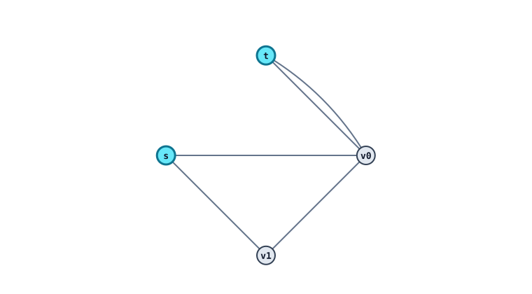
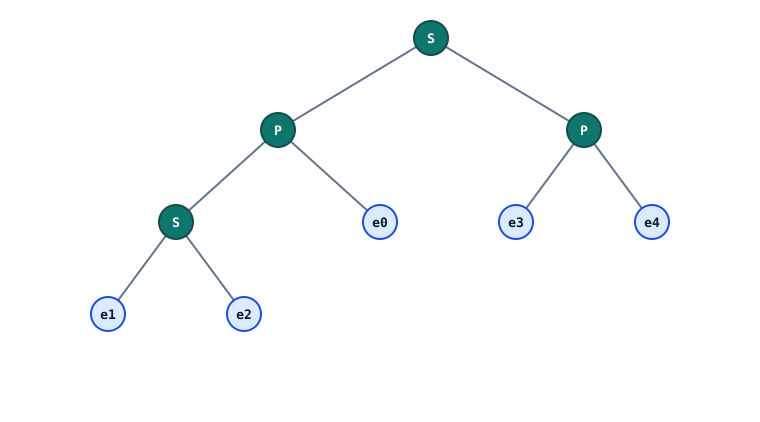
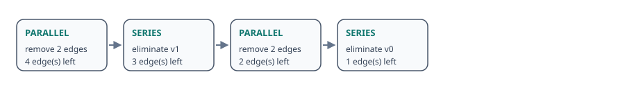
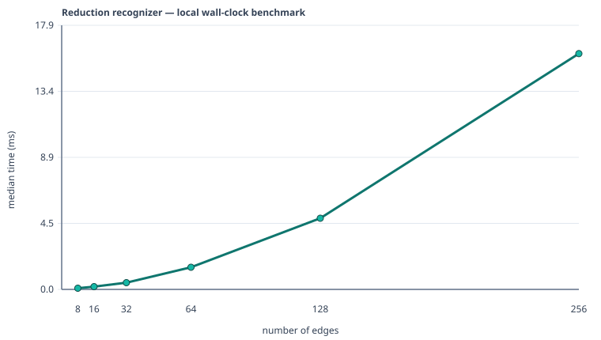

# Graph Algorithms Lab

Testable implementations, mathematical notes, and reproducible experiments for
graph algorithms, with an initial focus on **two-terminal series-parallel (TTSP)
graphs**.

This is an independent educational/research-engineering project based only on
public graph-theory literature. It does **not** contain code, data, or unpublished
results from my private undergraduate research.

## Scope of the first release

- A typed, loop-free undirected multigraph with stable edge identities
- Deterministic BFS, DFS, connected components, and connectivity
- TTSP construction by series and parallel composition
- Reproducible random TTSP generation
- Reduction-based TTSP recognition and S/P decomposition-tree construction
- A decomposition-tree dynamic program for two-terminal reliability
- An independent exhaustive edge-state implementation used as a test oracle
- Dependency-free SVG views of a graph, decomposition tree, and reduction trace
- Exhaustive small-instance tests and reproducible benchmarks

The project deliberately prioritizes a small, inspectable core over a large
collection of unrelated algorithms.

## TTSP graphs at a glance

A TTSP network has two distinguished vertices, source `s` and sink `t`. It is
defined recursively from a single terminal edge:

1. **Series composition** identifies the sink of one network with the source of
   the next.
2. **Parallel composition** identifies both pairs of corresponding terminals.

The construction is recorded by an **S/P decomposition tree**. This tree is both
a structural certificate and an algorithmic interface for dynamic programming.

| Network | Decomposition tree |
| --- | --- |
|  |  |

The recognizer applies inverse operations: it merges parallel edges and eliminates
nonterminal degree-two vertices until one terminal edge remains or no reduction is
possible.



## Quick start

```bash
python -m venv .venv
source .venv/bin/activate
python -m pip install -e ".[dev]"
pytest
ruff check .
ruff format --check .
```

```python
from graph_algorithms_lab import (
    edge,
    materialize,
    parallel,
    recognize_ttsp,
    series,
    terminal_reliability,
)

tree = series(parallel(edge(), edge()), edge())
network = materialize(tree)
result = recognize_ttsp(network.graph, network.source, network.sink)

assert result.is_ttsp
probabilities = {edge.id: 0.9 for edge in network.graph.edges}
print(terminal_reliability(network.decomposition, probabilities))
```

## Algorithmic claims and limits

- BFS/DFS and connectivity take `O(|V| + |E|)` time with adjacency incidence sets.
- Materialization and decomposition-tree DP take `O(|V| + |E|)` time.
- The current recognizer rebuilds reduction candidates after every step and has a
  conservative worst-case bound of `O((|V| + |E|)^2)`. It is intended as a clear
  reference implementation, not a reproduction of the linear-time recognizer of
  Valdes, Tarjan, and Lawler.
- Acceptance returns a constructive S/P tree. Tests provide computational evidence;
  they are not a substitute for a mathematical proof.
- The graph model is undirected, allows parallel edges, rejects self-loops, and
  recognizes TTSP with respect to a **specified terminal pair**.

See [docs/algorithms.md](docs/algorithms.md) for definitions, pseudocode,
complexity, correctness arguments, and stated assumptions.

## Verification strategy

The test suite separates implementation checks from mathematical claims:

1. Unit tests cover graph operations, composition, recognition, and invalid input.
2. Every ordered binary S/P construction expression through six leaves is
   materialized and recognized.
3. Every labeled simple graph on at most five vertices is compared with a separate
   test oracle that explores every valid reduction order.
4. The reliability DP is compared with independent enumeration of all `2^m` edge
   states for generated networks through eight edges.
5. A Wheatstone-bridge terminal network and disconnected graphs are negative cases.

Run the benchmark with:

```bash
python -m graph_algorithms_lab.benchmark \
  --sizes 8 16 32 64 128 256 \
  --repetitions 20 \
  --warmups 3 \
  --seed 2026
```

The checked-in results include raw CSV, environment metadata, and a generated SVG.
Wall-clock results are specific to the recorded machine and should be regenerated
before comparison.



## Repository map

```text
src/graph_algorithms_lab/  graph, TTSP, recognition, DP, SVG, benchmark code
tests/                     unit, exhaustive-construction, and oracle tests
docs/algorithms.md         definitions and algorithm analysis
docs/future-projects.md    plans for gnn-from-scratch and dynamic-graph-bench
docs/images/               reproducibly generated SVG figures
benchmarks/results/        measured data plus environment metadata
scripts/generate_docs.py   rebuilds the structural figures
```

## Reproducibility

```bash
python scripts/generate_docs.py
python -m graph_algorithms_lab.benchmark
```

Generation uses explicit seeds. Benchmark metadata records the Python version,
platform, processor string when available, timer, warmup count, and timestamp.

## References

- R. J. Duffin, “Topology of Series-Parallel Networks,” *Journal of Mathematical
  Analysis and Applications*, 10, 303–318, 1965.
  [doi:10.1016/0022-247X(65)90125-3](https://doi.org/10.1016/0022-247X(65)90125-3)
- J. Valdes, R. E. Tarjan, and E. L. Lawler, “The Recognition of Series Parallel
  Digraphs,” *SIAM Journal on Computing*, 11(2), 298–313, 1982.
  [doi:10.1137/0211023](https://doi.org/10.1137/0211023)
- D. Eppstein, “Parallel Recognition and Decomposition of Two Terminal
  Series-Parallel Graphs,” *Information and Computation*, 75(1), 15–38, 1987.
  [doi:10.1016/0890-5401(87)90061-7](https://doi.org/10.1016/0890-5401(87)90061-7)

These works motivate the graph class and decomposition viewpoint. The code here is
an independent, deliberately simple implementation; it is not copied from those
papers or from the private graduation-research repository.

## License

MIT is used as a permissive candidate license for the original code in this
repository. Before public release, confirm that all future contributions and assets
are owned or licensed compatibly. See [LICENSE](LICENSE).
